<div align="center">

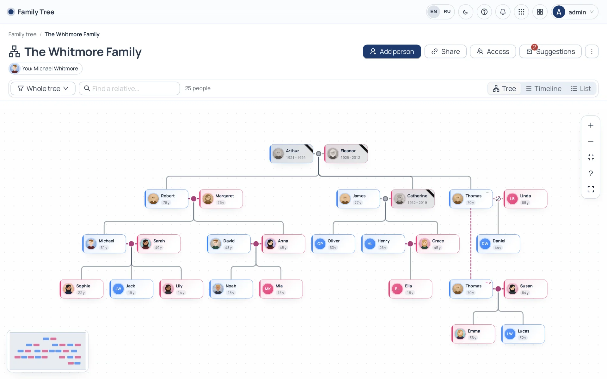

# Family Tree

**A self-hosted family tree that lays itself out, tells each life on a timeline, and can be shared with relatives as a link they can help complete.**

Built for real families: remarriages, unknown parents, half-siblings, people who are only remembered by a year. Your data stays on your server, in PostgreSQL.

[](LICENSE)


[Features](#features) · [Tour](#a-tour) · [Quick start](#quick-start) · [How it works](#how-it-works) · [API](#api) · [Security](#security--privacy)

</div>

---

## Why

Most family-tree tools either lock your family into someone else's cloud, or draw a chart that falls apart the moment a grandfather marries twice. This one is built the other way round:

- **The layout is automatic and honest.** Couples sit side by side, children hang from the middle of their parents' line, a person who married several times keeps every family — one under another — and a parent who is not known yet shows as a placeholder you can fill in later.
- **Dates can be as precise as memory.** `1950`, `March 1950` or `08.03.1950` are all valid; the app estimates what it does not know and shows it as an estimate.
- **Relatives help.** Share a branch as a link. Cousins open it without an account, introduce themselves, and send photos, dates and new relatives — you approve them, or let trusted links edit directly. Every action lands in an activity log.
- **It is yours.** One Docker container, your PostgreSQL, your files. Export to JSON or GEDCOM at any time.

## Features

<table>
<tr>
<td width="50%" valign="top">

### 🌳 The tree
- Automatic layout — no dragging boxes around
- Couples, remarriages one under another, step and adoptive parents
- Placeholders for an unknown mother or father — click to fill in
- Union states: married, partners, engaged, divorced, separated, widowed — with dates
- Compact cards: first name and age; frames coloured by gender
- A discreet mourning ribbon for those who have passed — years of life, *age at death* and *would be today*
- Pan, pinch-zoom, mini-map, "show the whole tree", search with jump-to

</td>
<td width="50%" valign="top">

### 🕰️ Timeline & list
- Every life as a bar on one axis of years
- Families as an outline: partner, then that couple's children, indented
- Wedding marks, branches dropping at each child's birth
- Unknown birth years estimated from relatives, drawn faded
- A list view with **data completeness** per person — see at a glance whose dates or photos are missing

</td>
</tr>
<tr>
<td valign="top">

### 👤 People
- Partial dates, places, occupation, a life story, contacts
- **"This is me"** — kinship labels everywhere: *Grandmother (father's side)*, *Uncle*, *Cousin*
- Portraits with a full-screen viewer: grows out of the avatar, pinch/scroll zoom, swipe down to close; the uncropped original is kept next to the square portrait
- Manual order of a person's marriages when dates are unknown
- A date picker made for genealogy: day and month may stay *unknown*

</td>
<td valign="top">

### 🔍 Views
- Saved views: *my family*, *father's side*, *mother's side*, *my ancestors*, *my descendants*, *everyone around me*
- Depth up and down, side branches (siblings → cousins → their children), partners on or off
- Inside a view the person panel shows only that view — and says how many relatives are hidden

</td>
</tr>
<tr>
<td valign="top">

### 🔗 Sharing with relatives
- Public links to the whole tree or to a view
- Access levels: **view**, **suggest** (you review) or **edit** (applied at once)
- Optional password, expiry date, "save a copy to my trees"
- Ask visitors for their **name** and, optionally or mandatorily, a **phone number**
- Per-link **theme**: as on device, light or dark — as a default or forced
- A friendly **helper robot** that explains what the link allows; draggable, remembers its spot
- A suggestions inbox with before → after diffs

</td>
<td valign="top">

### 🛡️ Ownership & control
- Per-tree access for users and groups: view / edit / manage
- **Activity log**: who opened a link, who proposed or changed what, through which link, when — with the visitor's name and phone (managers only)
- Clone a tree or a view into a new tree
- Import JSON (and the legacy *ftree* format), export JSON or GEDCOM
- Five languages: English, Russian, Kyrgyz, Turkish, Chinese
- Light and dark themes, mobile-first layouts, installable PWA

</td>
</tr>
</table>

## A tour

### The tree, in the dark

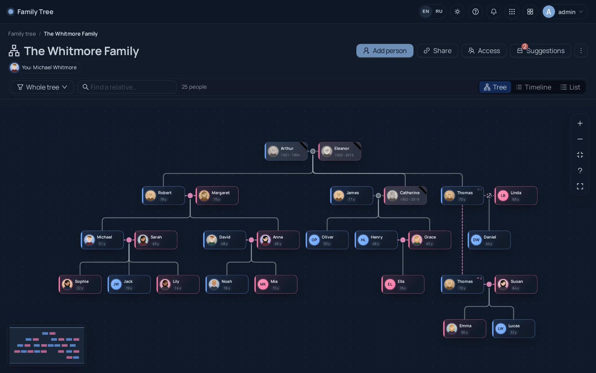

### A person, close up

Every person opens in a side panel: kinship to you, dates with *age at death* and *would be today*, places, a life story, partners with the state of each union, children and siblings.

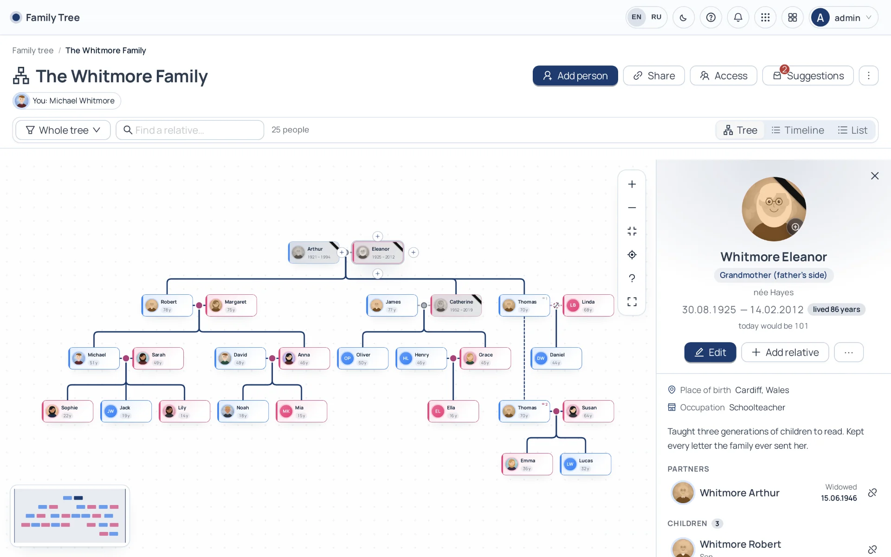

<table>
<tr>
<td width="50%"></td>
<td width="50%">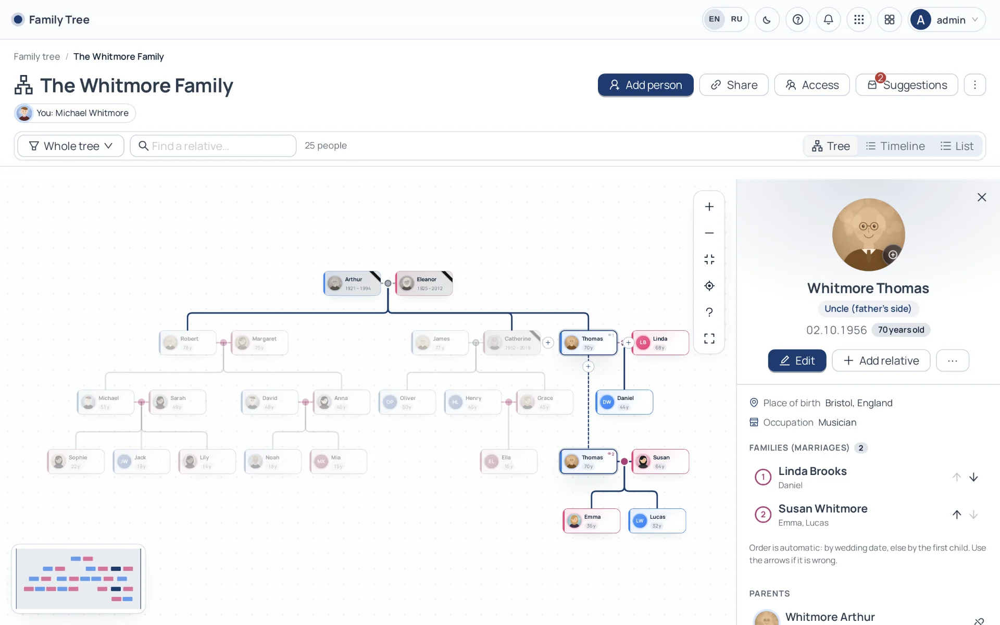</td>
</tr>
<tr>
<td align="center"><sub><b>Portrait viewer</b> — grows out of the avatar, zoom and pan, swipe to close</sub></td>
<td align="center"><sub><b>Remarriages</b> — each family on its own line, in the order you choose</sub></td>
</tr>
</table>

### Timeline, list and views

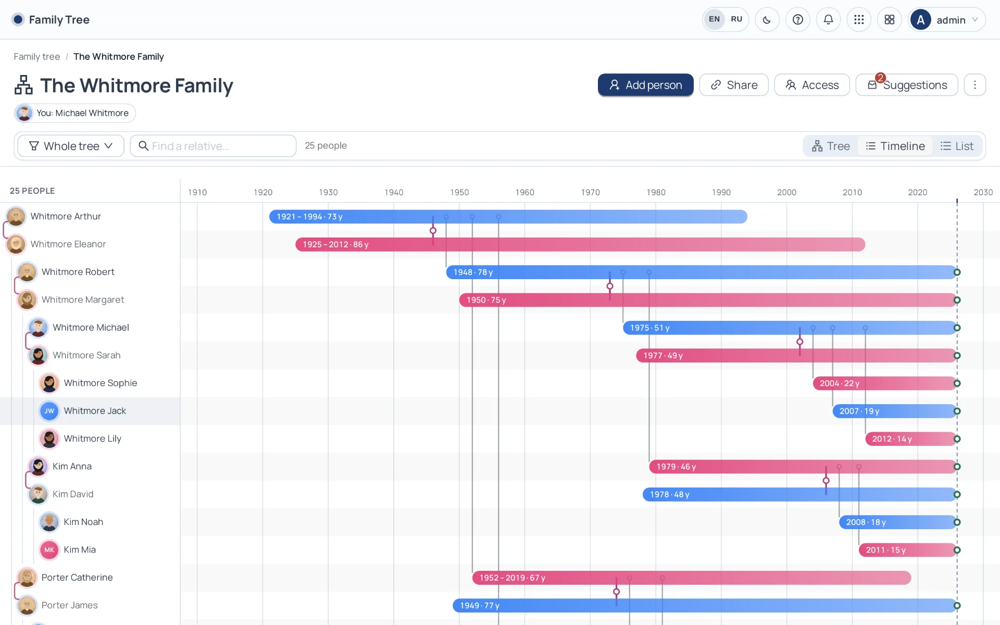

<table>
<tr>
<td width="50%">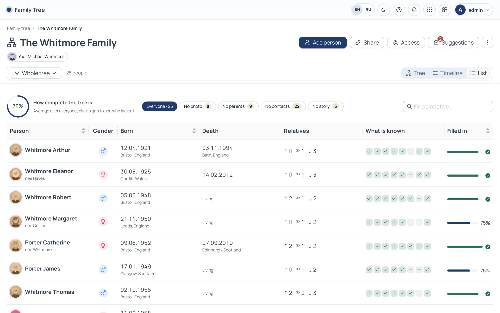</td>
<td width="50%">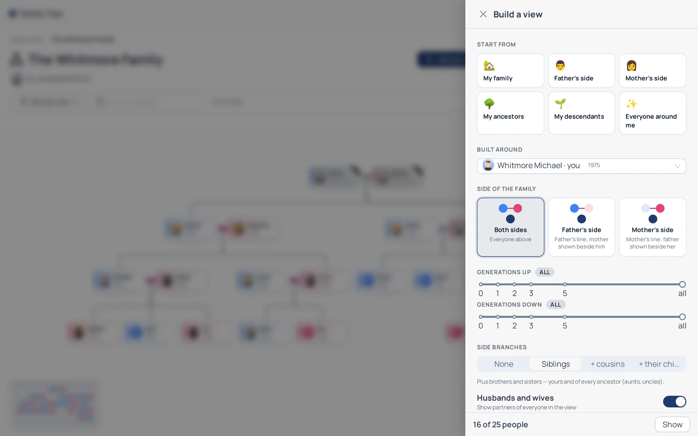</td>
</tr>
<tr>
<td align="center"><sub><b>List</b> — what is known about everyone</sub></td>
<td align="center"><sub><b>Views</b> — father's side, ancestors, everyone around me…</sub></td>
</tr>
</table>

### Sharing with relatives

<table>
<tr>
<td width="50%">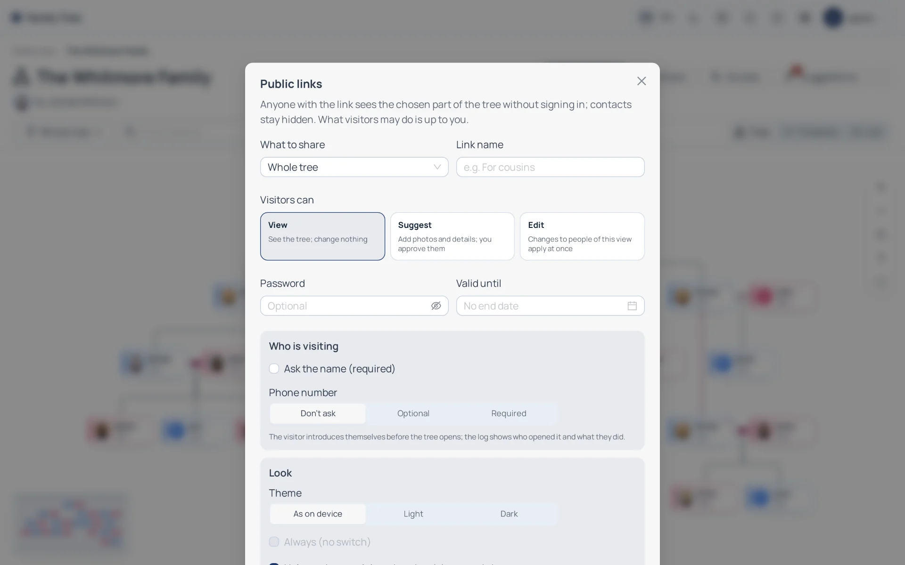</td>
<td width="50%">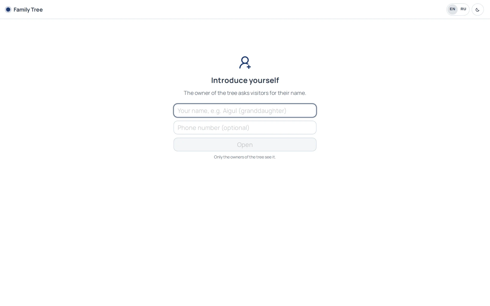</td>
</tr>
<tr>
<td align="center"><sub><b>Public links</b> — access, password, expiry, identity, theme</sub></td>
<td align="center"><sub><b>Introduce yourself</b> — the owner sees who did what</sub></td>
</tr>
</table>

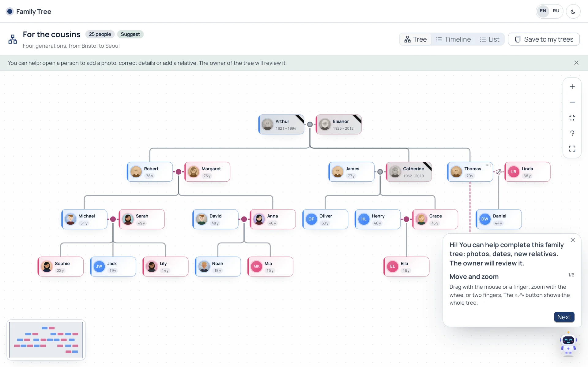

<table>
<tr>
<td width="50%">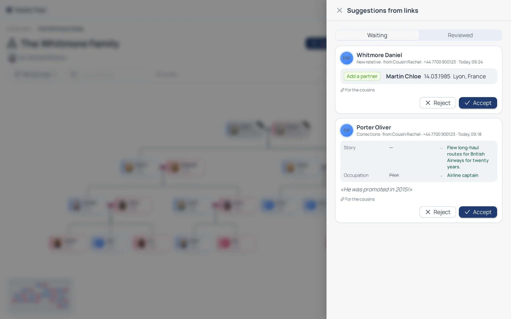</td>
<td width="50%">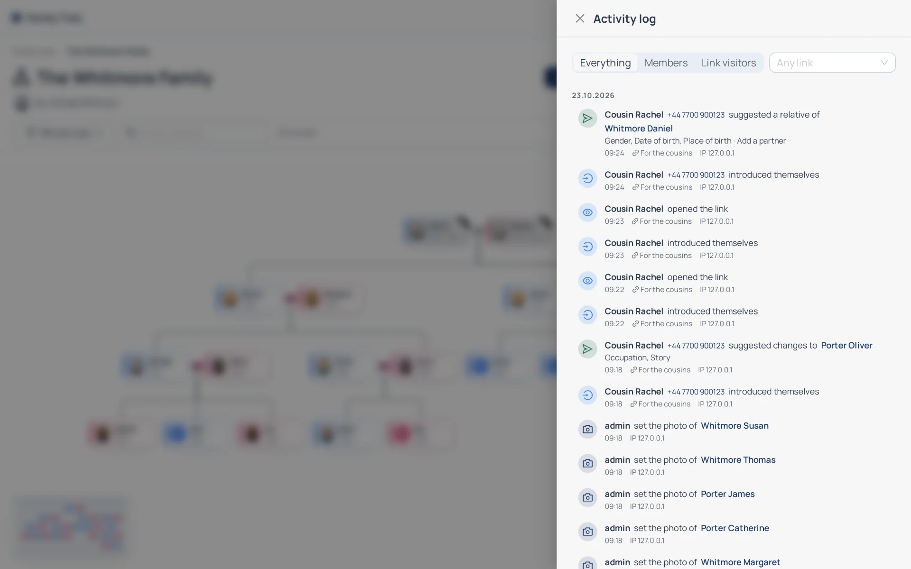</td>
</tr>
<tr>
<td align="center"><sub><b>Suggestions</b> — review proposals from relatives</sub></td>
<td align="center"><sub><b>Activity log</b> — every open, proposal and change</sub></td>
</tr>
</table>

### Made for phones

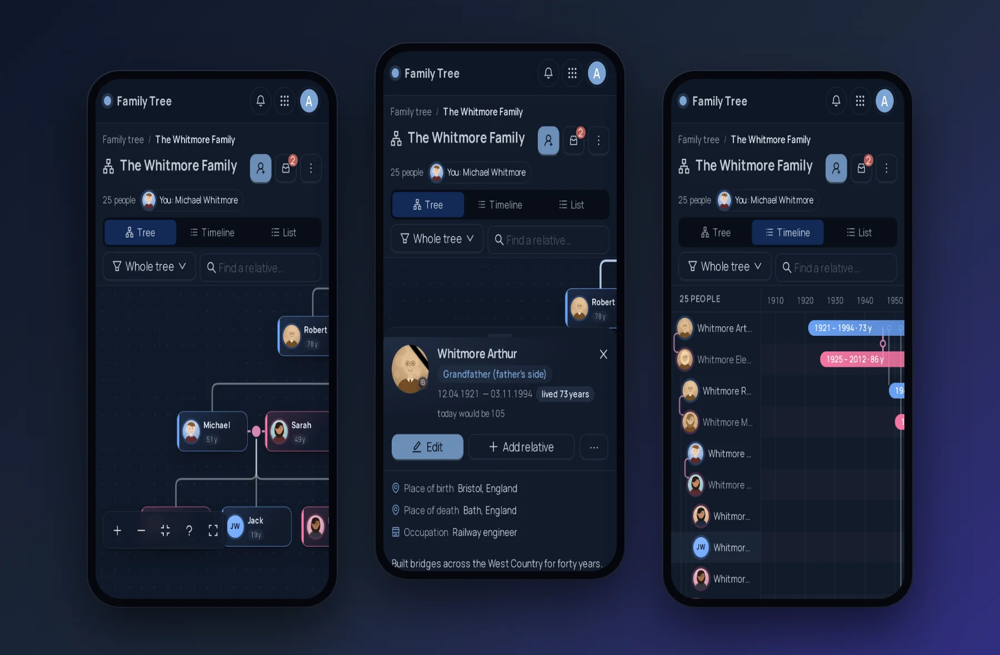

<p align="center">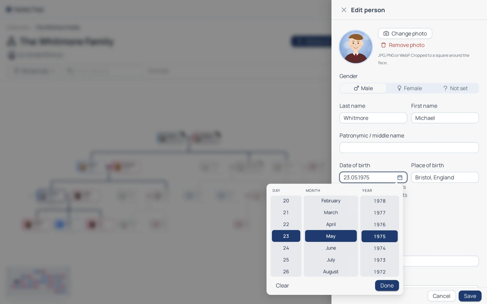<br/><sub><b>Dates as precise as memory</b> — type <code>04121981</code> or <code>1981</code>, or pick with the day and month left <i>unknown</i></sub></p>

> All people and portraits in these screenshots are fictional; the portraits are generated illustrations.

## Quick start

**You need:** Docker Engine with Compose v2 and a PostgreSQL 14+ server the container can reach ([creating the database](docs/postgres-setup.md)).

```bash
git clone https://github.com/iSmartyPRO/family-tree.git
cd family-tree

make env        # creates .env, generates JWT_SECRET and prints a SETUP_TOKEN
$EDITOR .env    # FRONTEND_URL, DOCKER_PORT, POSTGRES_*
make network    # creates the docker-lan network if missing
make up         # builds and starts the production container
make health
```

Open `http://127.0.0.1:8092` (or your `DOCKER_PORT`). The **setup wizard** asks for the `SETUP_TOKEN`, then the database, then the first administrator. After that, open **Family tree** from the app launcher, create a tree — or import one — and start adding people.

> [!TIP]
> Putting it on the internet? Run it behind a reverse proxy with TLS and set `FRONTEND_URL=https://…` so session cookies get the `Secure` flag. See [docs/platform.md → reverse proxy](docs/platform.md#deploying-behind-a-reverse-proxy).

### Local development

```bash
make dev                 # Docker: UI on :3020 (Vite), API on :3021, hot reload
# or without Docker (Node 22 + PostgreSQL):
make install
cd src/backend  && npm run dev    # API on :3001
cd src/frontend && npm run dev    # UI on :3000, proxies /api
```

### Tests

```bash
cd src/backend  && npm test             # tree rules, view selection, security, API
cd src/frontend && npm run i18n:check   # every key in all five languages
```

## Configuration

Bootstrap settings live in `.env` (template: [`.env.example`](.env.example)); everything else is edited in the admin console and stored in PostgreSQL.

| Variable | Default | Purpose |
|---|---|---|
| `DOCKER_NAME` / `DOCKER_PORT` | `family` / `8092` | Container name and published port |
| `FRONTEND_URL` | `http://localhost:8092` | Public origin; `https://` enables `Secure` cookies |
| `JWT_SECRET` | generated by `make env` | Signs sessions and visitor tokens — **required** in production |
| `SETUP_TOKEN` | generated by `make env` | Protects the first-run wizard |
| `POSTGRES_*` / `DATABASE_URL` | — | Database connection |
| `TRUST_PROXY_HOPS` | `1` | Reverse proxies in front of the app |
| `TZ` / `UPLOAD_DIR` | `UTC` / `/app/uploads` | Time zone and photo storage |

Module settings (**Console → Settings → Family tree**): the largest photo, whether public links are allowed at all, whether every link must have a password, and the longest a link may live.

## How it works

```
src/backend/modules/family/      Express routes over PostgreSQL (no ORM)
  schema.js        tables, created and migrated on start
  rules.js         pure checks: partial dates, two parents at most, no cycles, couples
  service.js       trees, people, links, photos, import / export (JSON, GEDCOM)
  selection.js     who a view shows (pure, tested)
  views.js         "me", saved views, cloning
  shares.js        public links: tokens, passwords, expiry, identity, theme
  suggestions.js   proposals from links: suggest / edit, review
  log.js           activity log

src/frontend/src/modules/family/   React + Ant Design
  layout.js        the tree layout
  timeline.js      lifelines
  kinship.js       "Grandmother (father's side)" labels
  components/      canvas, panels, dialogs, photo viewer, date picker, helper robot
  pages/           tree list, tree view;  PublicTree.jsx — the shared-link page
```

**The layout in short.** Couples (recorded, or implied by a shared child) form units; units are placed in generations; each subtree is packed against its neighbours by its per-row contour (Reingold–Tilford style), with parents centred over their children. A person with several families appears under themselves once per family, joined by a dashed "same person" line; a married-in person's other families sit beside the family they married into. Coordinates are never stored — the tree is laid out on every render, so edits never leave a mess. Details: [docs/family.md](docs/family.md).

**Partial dates** are stored as `YYYY`, `YYYY-MM` or `YYYY-MM-DD` and compared on the precision both sides have; missing birth years are estimated from relatives (±28 years a generation) for the timeline only.

**Photos** are prepared in the browser: a square portrait (640 px, centred on the face) for cards and an uncropped original (up to 2048 px) for the viewer. The server checks both by content and stores them outside the database.

## API

Everything the UI does is available as JSON — signed-in users at `/api/app/family/…`, anonymous visitors at `/api/t/:token/…`.

| | |
|---|---|
| Trees | `GET/POST /trees`, `GET/PUT/DELETE /trees/:id`, `PUT /trees/:id/access`, `POST /trees/:id/clone` |
| People | `POST /trees/:id/persons` (optionally with a `relation`: parent, child, partner, sibling, co-parent), `PUT/DELETE /persons/:id`, `POST/DELETE /persons/:id/photo` |
| Links | `POST /trees/:id/parents`, `POST /trees/:id/unions`, `PUT/DELETE /parents/:id`, `PUT/DELETE /unions/:id` |
| Views | `GET/POST /trees/:id/views`, `PUT/DELETE /views/:id`, `POST /trees/:id/select`, `PUT /trees/:id/me` |
| Sharing | `GET/POST /trees/:id/shares`, `PUT/DELETE /shares/:id`, `GET /trees/:id/suggestions`, `POST /suggestions/:id/accept` · `/reject`, `GET /trees/:id/log` |
| Data | `GET /trees/:id/export?format=gedcom`, `POST /trees/:id/import` |
| Public | `GET /t/:token`, `POST /t/:token/unlock` · `/hello` · `/suggest`, `POST /t/:token/persons/:id/photo` |

Personal API tokens and webhooks come with the platform — see [docs/public-api.md](docs/public-api.md).

## Security & privacy

- **Your server, your data.** No telemetry, no third-party services; photos stay on your disk.
- **Per-tree access control** for users and groups; module administrators see everything.
- **Public links** carry a random token, an optional bcrypt password (rate-limited unlocks), an expiry and a version bumped on revoke. Visitors only ever see and touch people inside the link's view, and contacts are never shown.
- **Visitor identity** is signed per link; a stricter rule (a phone now required) invalidates older introductions.
- **Suggestions are claimed atomically** — a double click cannot apply a change twice; link edits are serialised per tree, so the two-parents and no-cycles rules hold under concurrency.
- **Uploads** are allow-listed by extension, verified by magic bytes, stored under random keys and served with `nosniff` and a sandbox CSP.
- **Rate limits** on introductions, proposals, uploads, copies and pending proposals per link.
- The platform adds sign-in with lockouts, sessions, CSRF protection, IP allow-lists and an audit trail — see [docs/security.md](docs/security.md).

## Built on

This app is a module on **[iApp-Skeleton](https://github.com/iSmartyPRO/iApp-Skeleton)** — sign-in, roles, admin console, setup wizard, help, guided tours, notifications, PWA and a public API come from there. The platform's own guide is in [docs/platform.md](docs/platform.md).

| Layer | |
|---|---|
| Backend | Node.js 22, Express 4, `pg`, `multer`, JWT |
| Frontend | React 18, Vite, Ant Design 5 |
| Database | PostgreSQL 14+ |
| Delivery | One Docker image (nginx + Node), Compose |

## Contributing

Issues and pull requests are welcome. Please run the backend tests and `npm run i18n:check` before sending a change, and keep new interface text in all five languages. See [CONTRIBUTING.md](CONTRIBUTING.md).

## License

[MIT](LICENSE) © iSmartyPro
